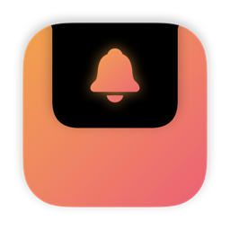
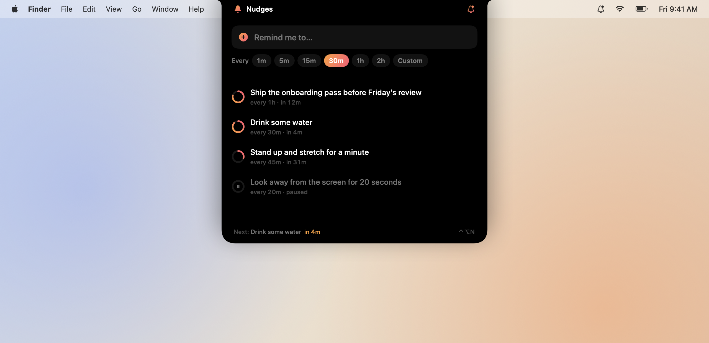
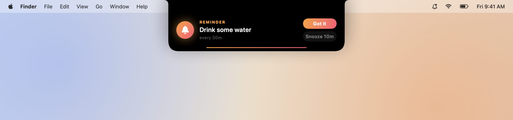
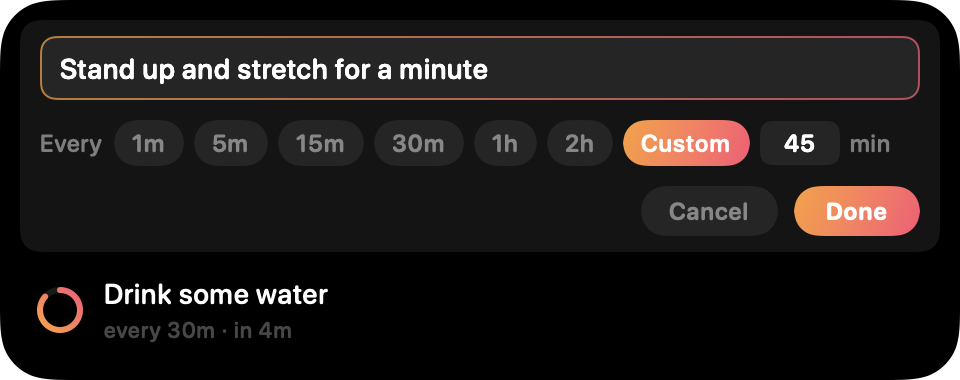
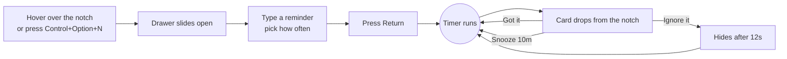
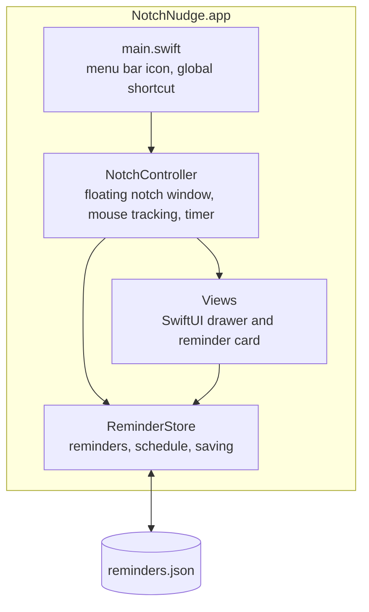

<div align="center">



# NotchNudge

**Gentle, repeating reminders that drop out of your MacBook's notch.**

Type what you want to remember, pick how often, and get on with your day.
Every so often, NotchNudge slides down from the notch, reminds you, and tucks itself away again.

[](https://github.com/sergxp/notchnudge/releases/latest)
[](https://github.com/sergxp/notchnudge/actions/workflows/ci.yml)


[](LICENSE)

[**Download for Mac**](https://github.com/sergxp/notchnudge/releases/latest/download/NotchNudge.dmg) &nbsp;&middot;&nbsp;
[Install guide](#install) &nbsp;&middot;&nbsp;
[How to use it](#how-to-use-it) &nbsp;&middot;&nbsp;
[Build from source](#build-from-source)

<br>



</div>

---

## Why NotchNudge?

Calendar alerts are for meetings. To-do apps are for tasks. But some things don't need a due date. You just need to see them again every so often: *drink water*, *stand up*, *ship the onboarding pass before Friday*.

NotchNudge lives in space you already ignore, the notch, so it never takes up room on your screen until it has something to say.

<div align="center">

</div>

## Features

<div align="center">

</div>

| | |
| --- | --- |
| **Lives in the notch** | Hover over the notch and the drawer slides open. Move away and it closes. No Dock icon, no windows. |
| **Repeating reminders** | Every 1, 5, 15, or 30 minutes, every 1 or 2 hours, or any custom number of minutes. Each one keeps its own schedule. |
| **Edit anytime** | Double-click a reminder (or click the pencil) to change its words or how often it repeats. |
| **Pops down on time** | When a reminder is due, a card drops from the notch with a soft chime. It hides itself after 12 seconds, and hovering keeps it open. |
| **Got it or Snooze** | Dismiss it until next time, or snooze it for 10 minutes. |
| **See what's coming** | A small ring on every reminder fills up as its next nudge gets closer. |
| **Pause anything** | Pause one reminder, or all of them at once (great for meetings and focus time). |
| **Global shortcut** | Press <kbd>Control</kbd> + <kbd>Option</kbd> + <kbd>N</kbd> from any app to open the drawer and start typing. |
| **Private** | No account, no internet, no tracking. Your reminders stay on your Mac. |
| **Tiny** | About a 1 MB download. Native Swift, runs on Apple Silicon and Intel. |

Works on Macs without a notch too: it appears as a small black tab at the top center of the screen.

---

## Install

**Requires macOS 14 (Sonoma) or newer.**

### Option 1: Download the installer (recommended)

1. Download **[NotchNudge.dmg](https://github.com/sergxp/notchnudge/releases/latest/download/NotchNudge.dmg)**.
2. Open it and drag **NotchNudge** into **Applications**.
3. Open NotchNudge from your Applications folder.

> [!IMPORTANT]
> **The first time you open it, macOS will warn you.** NotchNudge is free and open source, and it isn't signed with a paid Apple Developer certificate yet. To open it anyway:
>
> - **macOS 14 Sonoma:** right-click NotchNudge in Applications, choose **Open**, then click **Open** again.
> - **macOS 15 Sequoia and newer:** try to open it once, then go to **System Settings > Privacy & Security**, scroll down, and click **Open Anyway**.
>
> You only have to do this once.

### Option 2: One-line install (no warning)

Paste this into Terminal. It downloads the latest version, puts it in Applications, and opens it:

```bash
curl -fsSL https://raw.githubusercontent.com/sergxp/notchnudge/main/install.sh | bash
```

Run the same command again any time to update.

### Start at login

Click the bell in the menu bar and choose **Launch at Login**.

---

## How to use it



| To do this | Do this |
| --- | --- |
| Open the drawer | Hover over the notch, or press <kbd>Control</kbd> + <kbd>Option</kbd> + <kbd>N</kbd> |
| Add a reminder | Type it, choose how often, press <kbd>Return</kbd> |
| Edit one (words or timing) | Double-click it, or hover and click the pencil. Change it, then click **Done** |
| Pick any timing | Click **Custom** and type the number of minutes (1 to 1440) |
| Show, pause, or delete one | Hover over the reminder and use the buttons on the right |
| Pause everything | Click the bell in the top right of the drawer, or use the menu bar icon |
| Close the drawer | Move your mouse away, click anywhere else, or press <kbd>Esc</kbd> |
| See a reminder now | Menu bar icon > **Show Next Reminder Now** |
| Quit | Menu bar icon > **Quit NotchNudge** |

---

## Privacy

NotchNudge never connects to the internet. There are no accounts, analytics, or crash reporters.
Your reminders are saved in one file on your Mac:

```
~/Library/Application Support/NotchNudge/reminders.json
```

## Uninstall

Quit NotchNudge from the menu bar, then delete it from Applications. To also remove your reminders:

```bash
rm -rf ~/Library/Application\ Support/NotchNudge
```

---

## Build from source

You only need the free Xcode Command Line Tools (`xcode-select --install`). No Xcode project, no dependencies.

```bash
git clone https://github.com/sergxp/notchnudge.git
cd notchnudge
./scripts/build.sh          # builds build/NotchNudge.app
open build/NotchNudge.app
```

| Script | What it does |
| --- | --- |
| `scripts/build.sh` | Builds the app for Apple Silicon and Intel |
| `scripts/package.sh` | Builds the `.dmg` installer and `.zip` in `dist/` |
| `scripts/screenshots.sh` | Re-draws the README images and app icon from the real app screens |

### How it's built



---

## Roadmap

- [ ] Signed and notarized builds (no first-launch warning)
- [ ] Custom intervals and quiet hours
- [ ] Reminders at a set time of day
- [ ] Homebrew cask

Have an idea? [Open a feature request](https://github.com/sergxp/notchnudge/issues/new?template=feature_request.md).

## Contributing

Bug reports and pull requests are welcome. See [CONTRIBUTING.md](CONTRIBUTING.md).

## License

[MIT](LICENSE) &copy; 2026 Serge Petrenko
